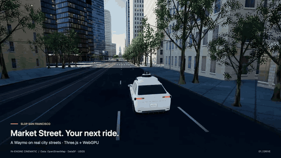
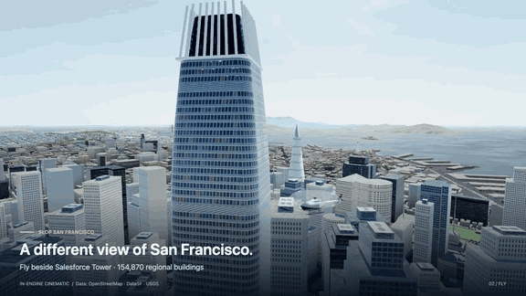

# Slop San Francisco

**Made by [@unable0_](https://x.com/unable0_)** — the San Francisco adaptation of [mrdoob’s Slop New York](https://github.com/mrdoob/slop-newyork).

**Walk the hills. Drive Market Street. Fly above the skyline.**

A data-built San Francisco running in your browser with [three.js](https://threejs.org/), WebGPU and TSL.
Explore on foot, by bike, in a Waymo robotaxi or by helicopter—or take the assisted ride from the Ferry Building to Nob Hill.

**Status: playable demo.** The downtown ride, city exploration, sound and responsive controls are implemented.
See [known limitations](#known-limitations) for the remaining simplifications. Run it locally using the steps below;
there is currently no hosted demo URL configured for this repository.

## See it in motion

**Market Street · a Waymo through downtown**



**Salesforce Tower · fly above the skyline**



These two animated GIFs play directly in GitHub’s README. They are silent, five-second excerpts from actual
engine captures, with staged vehicle/camera paths and traffic disabled for filming. The Waymo clip uses the
latest cohesive car model and a roadway camera angle that keeps foreground trees out of the shot.
[How the clips were made](docs/media/README.md).

### A city, from street level to skyline

| Detailed downtown core | Wider city scenery | Ways to explore |
|:---:|:---:|:---:|
| **15,735** building records | **154,870** regional buildings | **4** movement modes |
| Real streets, curbs, terrain and collisions | San Francisco, with Marin and the East Bay on the horizon | Walk · Drive · Cycle · Fly |

The counts describe the committed datasets, not buildings visible in one frame. Regional buildings use simplified
geometry; the detailed core has the driving network and collisions. Sources: [core building audit](docs/reports/building-types-core.md)
and [regional data report](docs/reports/region.md).

- **A complete first ride:** passenger pickup, turn guidance, junction right-of-way, hill climbing and drop-off at Nob Hill.
- **A living city:** cars, buses, pedestrians, surface transit, ferries and changing light.
- **San Francisco's terrain:** real hills, recognizable landmarks, marine fog and a searchable terrain map.
- **A detailed player Waymo:** dedicated crossover body, roof/fender sensors, modeled grille, split-spoke wheels and clearcoat paint. [Model notes](docs/vehicles/waymo.md).
- **Sound in every mode:** footsteps, bicycle motion, electric motor/road noise and helicopter rotor/wind.

City data comes from OpenStreetMap, DataSF and USGS. The original engine credit and source-specific terms
are preserved in [NOTICE.md](NOTICE.md) and the [data-source guide](docs/data-sources.md).

## Run it

Use Node.js 22 or newer and a browser with WebGPU enabled. Chrome or Edge are the recommended starting point.
The runtime data is included in the repository: no package install, API key or data download is needed to play.

```bash
node tools/serve.mjs
```

Then open http://127.0.0.1:8080. Keep the terminal running. Three.js loads from a pinned CDN URL, so the first
start needs internet. Use a local server rather than opening `index.html` as a file.

For the featured demo, choose **First ride → Start at the Ferry Building**. For a quick skyline tour, choose
helicopter mode and a flight destination in the Teleport menu. Turn on **Sound** to hear the current mode.

## Controls

| Key | |
|---|---|
| `1` `2` `3` `4` | Walk, drive, cycle, fly |
| `W` `A` `S` `D` or arrow keys | Move and steer |
| `Shift` | Sprint or boost |
| `Space` / `E`, `Q` / `C` | Helicopter up and down |
| `V` | Change camera |
| `M` | Map |
| `R` | Reset to a nearby clear road |
| `Esc` | Pause/settings; close the map or an open menu |
| `H` | Hide/show the HUD |

Use the Teleport menu (top right) to jump to the Ferry Building, Coit Tower, Lombard Street, Oracle Park and other landmarks.
Use the Fog menu for Clear, Light haze or Marine layer (`?fog=clear|haze|marine`). Helicopters can explore
the wider region; walking and driving remain in the detailed north-east core. Destinations marked “Fly” switch to the helicopter.

Settings pause the simulation and offer time, fog, downtown traffic density, shadows and Low/Medium/High quality.
Automatic quality samples three seconds after startup. Low removes reflections and sun shadows and limits regional buildings
to 3 km; Medium uses 5 km; High uses 8.5 km. Use `?quality=low|medium|high` for a repeatable comparison.
The map supports search, pan, zoom and click-to-teleport. Outside the driving core, map arrivals switch to flight.

## Ferry Building to Nob Hill

Choose **First ride**, then **Start at the Ferry Building**. Stop in the amber ring and pick up your passenger.
Assisted driving follows connected street lanes through Washington, Sansome and California Street, obeying signals
and yielding to traffic. The map shows the actual route; the ride card gives the next turn and remaining distance.
Allow 5–12 minutes depending on traffic. Stop at Nob Hill and choose **Drop off passenger** to finish.

**Take the wheel** (or a movement key) switches to manual driving. **Resume assisted driving** returns control;
**Recover** appears when you leave the route. Changing mode or teleporting ends the ride. Closing the ride card
keeps the trip running; Settings and the full map pause the city.

The toolbar's **Sound** button works everywhere: rotor and wind when flying, footsteps while walking,
chain/tire sound when cycling, and an electric motor hum and road noise when driving. The ride adds door,
turn and arrival chimes. Audio is synthesized locally, starts only after a click, and mutes while paused or
in a hidden tab. Starting a ride enables sound unless you have explicitly muted it. Sound starts off after reload.

## How it was built

The project adapts mrdoob’s browser city engine to San Francisco. The runtime is a static HTML/CSS/JavaScript
application using Three.js, WebGPU and TSL shaders; it has no application backend or runtime bundler.

1. **Build the geography offline.** Tools fetch DataSF streets, building footprints, curbs, tree inventories and
   other city layers, OpenStreetMap geometry/tags, and USGS elevation. The pipeline projects them into one local
   coordinate frame, records source provenance and writes compact runtime arrays and binary terrain/building data.
2. **Put the city on its hills.** Terrain height queries place streets, sidewalks, buildings and moving actors
   on the same surface. Grade-separation metadata handles tunnels, freeway decks and streets below structures.
3. **Generate the detailed core.** Building footprints become procedural masses and neighborhood-specific facades.
   Dedicated landmark models supply the skyline; inventory trees, transit lines and street furniture add detail.
   The player Waymo uses its own detailed body, wheels and sensor geometry.
4. **Extend the view across the bay.** Regional terrain and simplified building instances fill the wider city.
   Instancing, distance culling and terrain levels of detail control the rendering workload. Marine fog is composed
   from scene depth, with time-of-day lighting, reflections and bloom.
5. **Drive through a connected street network.** Lanes, turn connectors, signals and grouped-junction right-of-way
   support traffic and the curated Ferry-to-Nob Hill trip. The ride supplies steering/speed targets to the same
   player controller, with pickup, drop-off, route guidance, manual takeover and recovery.
6. **Keep interaction consistent.** Exact building outlines and a shared car footprint handle wall contact and
   safe placement. Small movement steps prevent tunneling; contact retains wall sliding. Web Audio synthesizes
   movement and ride sounds locally. The map, pause menu and responsive toolbar share the same runtime state.

| Where to look | What it explains |
|---|---|
| [Runtime architecture](docs/ARCHITECTURE.md) | Modules, data flow, rendering, traffic, audio and collision handling |
| [Data sources](docs/data-sources.md) · [NOTICE](NOTICE.md) | Datasets, provenance, transformations and attribution |
| [First ride](docs/phases/phase-8-first-ride.md) | Trip behavior, right-of-way and acceptance evidence |
| [Waymo model](docs/vehicles/waymo.md) | Procedural model construction and visual limits |
| [Performance log](docs/perf-log.md) | Measured results, hardware/context limitations and methods |
| [Building contact review](docs/review/p9-buildings/index.md) · [Toolbar review](docs/review/hud-responsive/index.md) | Latest collision and responsive-layout checks |
| [Showcase capture guide](docs/media/README.md) | Reproduce the GIFs and full-length clips |

The original `window.NYC` namespace remains an internal compatibility detail; the rendered geography, map,
destinations and user-facing identity are San Francisco. Earlier phase reports are historical snapshots,
not the current project status.

## Regenerate data

Runtime data is committed; these commands are only needed to rebuild it. Install the offline tool dependencies in `tools/`
with `npm ci --prefix tools`, then fetch the source snapshots (network access and substantial disk space required):

```bash
node tools/fetch-geodata.mjs --box core
node tools/fetch-geodata.mjs --box city
node tools/fetch-geodata.mjs --box landmarks
node tools/fetch-horizon.mjs
node tools/fetch-geodata.mjs --box horizon --only osm --osm coast
node tools/fetch-geodata.mjs --box horizon --only osm --osm ferries
node --max-old-space-size=8192 tools/build-geodata.mjs core
node --max-old-space-size=8192 tools/geo-region.mjs
curl --fail --location 'https://data.sfgov.org/resource/j2bu-swwd.geojson' -o data/raw/neighborhoods-p7.geojson
node tools/geo-neighborhoods.mjs
```

Use the same snapshots/hashes for reproducibility. See [data sources](docs/data-sources.md) and
[architecture](docs/ARCHITECTURE.md). The optional `node tools/build-static.mjs` creates a local `dist/` package; it does not deploy.

## Build a static demo

```bash
node tools/build-static.mjs
```

Serve the generated `dist/` directory over HTTPS or localhost on a static host. Keep the `data/` directory,
`LICENSE` and `NOTICE.md` in the deployment. Three.js still loads from its pinned CDN. This command only
packages the app; it does not publish it. The developer recording/review tools are excluded from the package.

## Known limitations

This is a stylized city demo, not a street-accurate simulator or a general autonomous-driving system. The assisted
ride is a curated route; it does not promise arbitrary destination routing. Tree trunks are not solid obstacles,
and pedestrians do not yet react physically to vehicle impacts. Some road/terrain seams and decorative landmark
collision approximations remain. Those are deferred improvements, not unfinished setup steps.

Traffic rules and signals are approximations. Facade styles use neighborhood tables, not surveys of each building.
The wider city is simplified scenery without the core’s full driving network or building collisions. Marine fog is a
screen-space depth approximation for transparent objects. Performance results apply to the measured machine; browser and
GPU support vary. A clear error screen explains unavailable WebGPU. No crash camera shake is added; reduced-motion settings
suppress decorative CSS animation.

## Tests

```bash
node --test --test-concurrency=1 tests/*.test.cjs tests/*.test.mjs
```

The last complete building-collision regression passed **198/198 tests**, including three full-city assisted rides
with zero recorded world contacts, traffic impacts or traffic overlaps. The subsequent toolbar pass passed its
five boot/settings checks and browser layout checks at nine widths from 320 to 1440 px. These are recorded checks,
not a guarantee for every GPU, browser or traffic scenario. Serial test scheduling reduces timing contention.

## License and credits

- **Code:** [MIT License](LICENSE), with the original copyright notice for Mr.doob preserved and a notice for
  Kamil ([@unable0_](https://x.com/unable0_)) covering the San Francisco contributions. Retain the copyright and
  permission notices when redistributing the software. [Standard MIT text](https://opensource.org/license/mit).
- **Original project:** [slop-newyork](https://github.com/mrdoob/slop-newyork) by mrdoob, imported at `0049a49`.
- **Rendering:** [three.js](https://threejs.org/), under its own MIT license.
- **Geographic data:** MIT does not replace the source data licenses. DataSF layers use PDDL/CC0 as documented
  per source; USGS elevation is public-domain US government data; OpenStreetMap-derived data is under ODbL 1.0.
  See [NOTICE.md](NOTICE.md) and [data sources](docs/data-sources.md) for attribution and redistribution details.

The Waymo depiction is independent procedural artwork, not an official vehicle model or an affiliated product.
