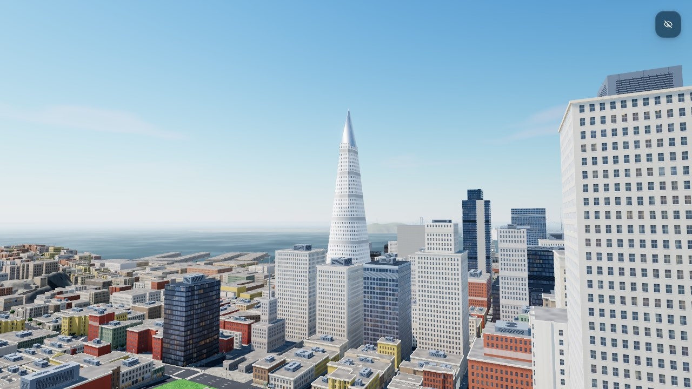

# Slop San Francisco



San Francisco in the browser, built with [three.js](https://threejs.org/), WebGPURenderer and TSL. Walk, drive, cycle or fly
through the city's north-east quarter on its real hills. The streets, curbs and building heights come from real data, and
the cars stop at the real signals and stop signs.

A port of [Slop New York](https://github.com/mrdoob/slop-newyork) by mrdoob. Work in progress: phase 5 of 7 is done. The
landmarks and both bridges are in. The rest of the city is still bare ground, and the map and some camera presets still show New York.

## Run it

You need Node and a browser with WebGPU (a recent Chrome or Edge). There's no install or build step.

```bash
node tools/serve.mjs
```

Then open http://127.0.0.1:8080. three.js loads from a CDN, so the first start needs internet.

## Controls

| Key | |
|---|---|
| `1` `2` `3` `4` | Walk, drive, cycle, fly |
| `W` `A` `S` `D` or arrow keys | Move and steer |
| `Shift` | Sprint or boost |
| `Space` / `E`, `Q` / `C` | Helicopter up and down |
| `V` | Change camera |
| `M` | Map |

Use the Teleport menu (top right) to jump to the Ferry Building, Coit Tower, Lombard Street, Oracle Park and other landmarks.

## Tests

```bash
node --test tests/*.test.cjs tests/*.test.mjs
```

## License and data

The code is under the [MIT License](LICENSE). The data comes from DataSF (PDDL), USGS 3DEP and
© [OpenStreetMap contributors](https://www.openstreetmap.org/copyright) (ODbL). See [NOTICE.md](NOTICE.md).
