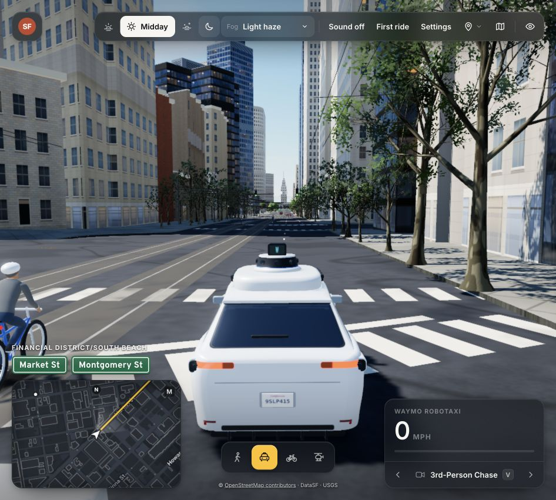

# Responsive top controls — 2026-10-23

The screenshot is the actual 946×850 WebGPU preview. The brand and toolbar share a wrapping layout;
the brand reduces to the SF badge at compact desktop widths and steps aside below 820 px. The fog selector
uses the toolbar typography, height and glass background, next to the time controls. It remains a native
select with keyboard support and visible focus. No fog rendering or road mesh changes in this pass.

Browser DOM bounds checked at 320, 390, 700, 820, 946, 1080, 1100, 1280 and 1440 CSS pixels: no overlap among
visible brand/toolbar controls, and none outside the viewport. At 390 px the toolbar uses two rows; at 320 px
it uses three. The ride card opens 12 px below the actual toolbar bottom (110 px versus 98 px at 390 width).
Marine layer selection synchronizes to Settings; light haze restored. Clean view hides/restores controls.
These are desktop browser viewport checks, not a claim of testing physical touch hardware or the entire mobile HUD.

5/5 existing boot/settings tests pass. Static build, main.js syntax and whitespace checks pass. The earlier
198-test collision result is unchanged; the full driving suite was not rerun for this presentation-only pass.
