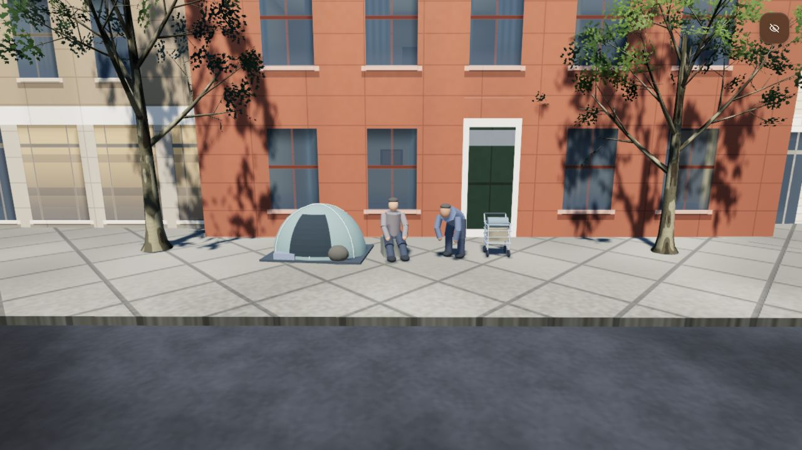
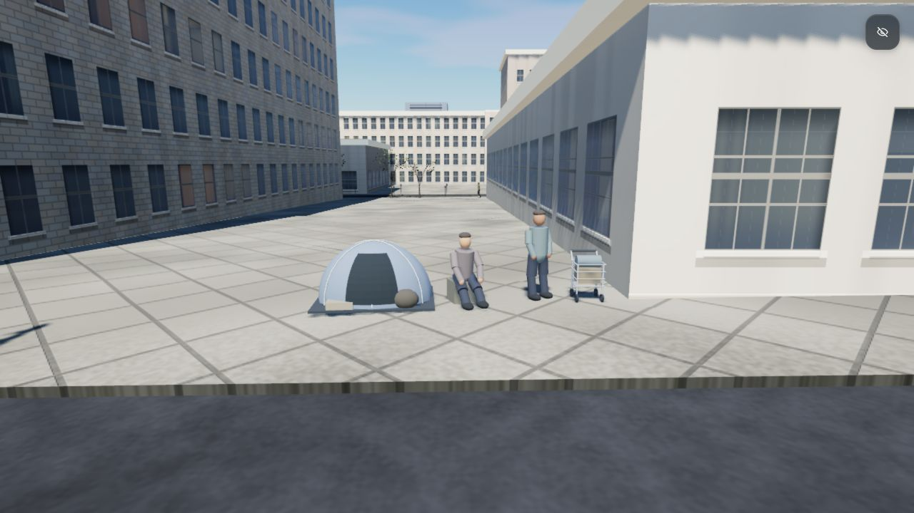
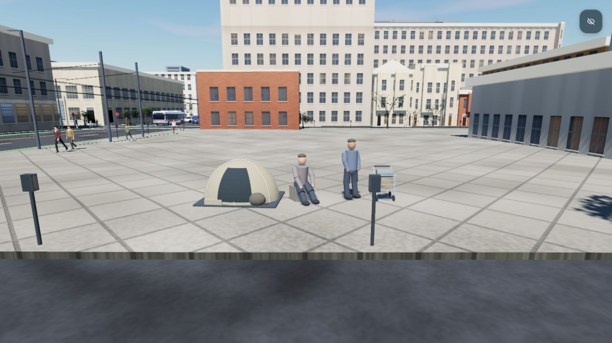

# Small sidewalk scenes

Three authored scenes near Market and 6th, Mission and 6th, and Howard and 5th. In total: three low dome tents,
six people (seated, standing and one hunched pose), folded blankets, bags and three small shopping carts.
These are fictional scenery compositions, not a record of actual residents or current encampment locations.

## Placement and scope

- Sites are selected from the named road junctions, away from crosswalks, using the existing core street data.
- The complete six-metre scene and an adjacent 1.6 m walking strip are checked against sidewalk coverage,
  exact building outlines, terrain slope, trees, lamps, shelters, hydrants and parking meters.
- Ambient pedestrian paths avoid the oriented scene footprints. The walking strip remains usable.
- Each scene is one merged, vertex-colored mesh with the existing spatial/shadow culling. No new textures,
  downloads, lights, animation loop or citywide scattering pass.
- Figures are static scenery. Player impacts, ragdolls, tree collisions and other previously deferred physics
  are not introduced by this change.

## Review

All three sites were viewed in the local WebGPU preview at High/Midday, clear fog, 1280×720. No browser
warnings or errors. Three focused checks use real buildings, terrain and generated street furniture to verify
site coverage, obstacle clearance, pedestrian passage and safe skipping when no sidewalk is available.
Full serial regression: **201/201 pass**, no skips or retries, in 152.8 s. All three traffic-seeded assisted
rides report zero building contacts, traffic contacts and overlaps. An earlier focused run exceeded the
unchanged road-network timing limit while the preview was rendering; it passes in the full serial run
(1.48 s including fixture setup). Static packaging verifies 416 assets, including the new runtime module.

Camera URLs (append to the local server or published demo):

- Market: `?quality=high&time=midday&fog=clear&cam=-761,16.5,762,-135,-11&hud=0`
- Mission: `?quality=high&time=midday&fog=clear&cam=-524,14.3,803.5,-135,-11&hud=0`
- Howard: `?quality=high&time=midday&fog=clear&cam=-271,9.9,824.8,-135,-11&hud=0`
